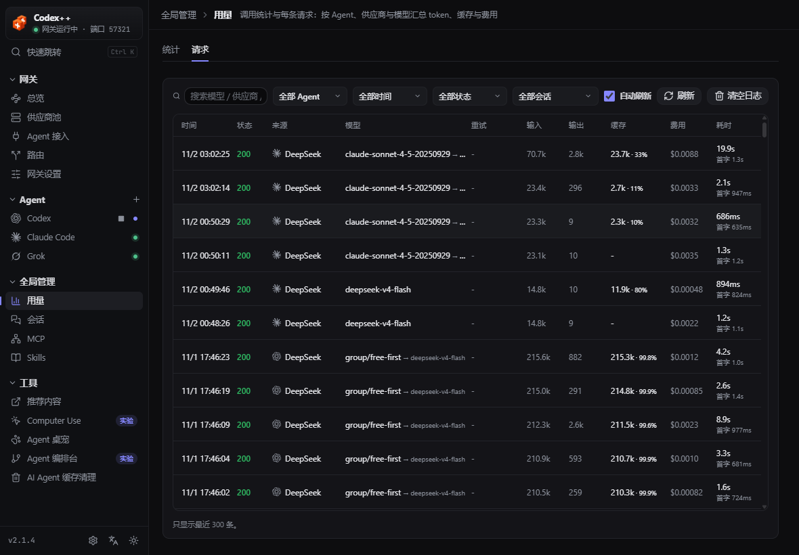

# Sia-Codex

> **Sia-Codex** 是本仓库维护的 CodexPlusPlus 非官方 AGPL 下游版本，不代表
> BigPizzaV3 或 OpenAI 官方。基线为 CodexPlusPlus `v2.1.4`
> （`59bdcf1c020fa8f561e9607ee99d0e85d73b52e8`），按 AGPL-3.0-only 分发。
> 来源、修改范围与商标边界见 [FORK-NOTICE.md](FORK-NOTICE.md)。

这个 README 只说明 Sia-Codex 相对上游增加、修改或明确停用的内容。供应商切换、
协议转换、会话管理、MCP、Skills、插件市场等继承功能不再在这里重复演示，请以
[上游项目说明](https://github.com/BigPizzaV3/CodexPlusPlus)为基线。

## Sia-Codex 的不同

### 三省六部式 Agent 编排

- 中书省负责拆解目标、生成带依赖的任务图。
- 门下省独立审核方案，不参与执行。
- 六部角色按能力与额度执行，可并行使用隔离 worktree。
- 宰相负责汇总、复核、冲突裁决和最终验收。
- 支持任务依赖、并发上限、取消、重试、SSE 实时事件和自动合并。

相关文档：

- [编排协议](docs/sansheng-orchestration-protocol-v1.md)
- [Agent 协作说明](docs/agent-collaboration.md)
- [本地下游维护方式](docs/LOCAL-DOWNSTREAM.md)

### 下游更新策略

Sia-Codex 不自动跟随上游 Release：

- 管理器最多提示上游出现新版本。
- 不自动下载、安装或覆盖当前下游构建。
- 需要升级时先审查上游发布说明和源码差异，再有选择地移植到升级分支。

### 本地 Agent 与免费额度优先

- 支持 Codex、DeepSeek Harness、Claude Code、WorkBuddy 和 Trae CN 等本地 worker。
- 日常可拆分工作优先交给有免费额度的 worker。
- DeepSeek Harness 和 Claude Code 使用付费在线模型，不会在可替代时默认启用。
- 主代理保留任务拆解、方向裁定、冲突处理和最终验收职责。

### Windows / macOS Computer Use 共享

- 通过 MCP 把 Codex 桌面版的 Computer Use 能力提供给其它 AI 客户端。
- macOS 支持 JS 和原生离散工具两种操作方式。
- Windows 支持 JS 操作方式，可操作桌面窗口和 Chrome 标签页。
- Windows 暂不支持原生离散工具与 Codex++ 悬浮预览；客户端仍可读取 Computer Use 自己返回的截图。
- 首次操作某个应用时，仍走 Codex 原生应用审批和站点权限，不在本项目中另造一套放行机制。

### 新版原生浏览器协议

- 已适配 `@oai/browser-desktop@0.1.1` 的 managed request headers。
- 只为受支持的 Chrome / Edge 扩展补上 `x-browser-agent` 请求头。
- 未知扩展、未知协议或结构漂移会失败关闭，不写回不确定的服务。
- 本地验证命令：

```powershell
npm.cmd run test:native-browser-local --prefix apps/codex-plus-manager
```

## 当前界面约定

请求日志已经并入 **全局管理 → 用量** 页面，不再有独立的“请求日志”侧栏入口：

- “统计”页查看按 Agent、供应商和模型汇总的 token、缓存与费用。
- “请求”页查看每条请求的状态、模型、重试、token、缓存、费用和耗时。



Agent 编排台位于 **工具 → Agent 编排台**。Computer Use 位于
**工具 → Computer Use**。

## 构建与验证

Windows 上建议把 Cargo 目标目录和运行时依赖放在 D 盘，避免占用系统盘：

```powershell
$env:CARGO_TARGET_DIR = "D:\dev-tools\cargo-target\codexplusplus"
npm.cmd ci --prefix apps/codex-plus-manager
npm.cmd run check --prefix apps/codex-plus-manager
npm.cmd test --prefix apps/codex-plus-manager
cargo test -p codex-plus-core --lib
npm.cmd run build --prefix apps/codex-plus-manager
```

## 隐私与支持

- 不提交 API Key、Cookie、账号标识、本机私人路径或未脱敏日志。
- 下游问题请使用 [Sia-Codex Issues](https://github.com/shiziluk/Sia-Codex/issues)。
- 上游继承功能的通用说明与历史讨论请查阅上游仓库；下游构建问题不要伪装成上游官方答复。

## 许可证

本仓库按 [AGPL-3.0-only](LICENSE) 分发。上游代码、第三方依赖和商标仍归各自权利人。
