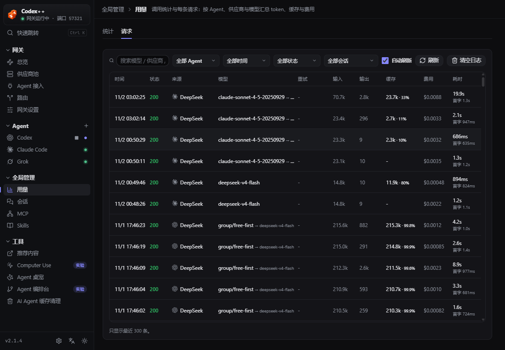

# Sia-Codex

> **Sia-Codex** is an unofficial AGPL downstream build maintained in this
> repository. It is not an official release by BigPizzaV3 or OpenAI. The baseline
> is CodexPlusPlus `v2.1.4` (`59bdcf1c020fa8f561e9607ee99d0e85d73b52e8`) and is
> distributed under AGPL-3.0-only. See [FORK-NOTICE.md](FORK-NOTICE.md) for
> provenance, changes, and trademark boundaries.

This README documents only what Sia-Codex adds, changes, or disables compared with
upstream. Inherited provider switching, protocol conversion, session management,
MCP, Skills, and plugin-marketplace features are intentionally not repeated here.
Use the [upstream README](https://github.com/BigPizzaV3/CodexPlusPlus) as the
baseline for those features.

## What Is Different

### Three Departments agent orchestration

- A planner decomposes the objective into a dependency-aware task graph.
- A separate reviewer audits the plan without editing the result.
- Executor roles run in parallel with isolated Git worktrees when needed.
- A final controller stage integrates artifacts, resolves conflicts, and accepts or rejects the result.
- Supports dependencies, concurrency limits, cancellation, retries, SSE events, and optional auto-merge.

Relevant documents:

- [Orchestration protocol](docs/sansheng-orchestration-protocol-v1.md)
- [Agent collaboration](docs/agent-collaboration.md)
- [Local downstream maintenance](docs/LOCAL-DOWNSTREAM.md)

### Downstream update policy

- Upstream releases only produce a notification.
- Sia-Codex never downloads, installs, or overwrites itself automatically.
- Maintainers review upstream notes and source diffs, then port selected changes into a dedicated upgrade branch.

### Local agents and free-quota routing

- Supports local workers including Codex, DeepSeek Harness, Claude Code, WorkBuddy, and Trae CN.
- Separable routine work prefers workers with daily free quota.
- DeepSeek Harness and Claude Code use paid online models and are not selected by default when a suitable free worker is available.
- The primary agent remains responsible for decomposition, routing, conflict resolution, and final verification.

### Computer Use sharing on Windows and macOS

- Exposes the Codex desktop app's Computer Use through MCP to other AI clients.
- macOS supports JS mode and the native discrete-tool mode.
- Windows supports JS mode for desktop windows and Chrome tabs.
- Windows does not currently support native discrete tools or the Codex++ floating preview. Clients can still receive screenshots returned by Computer Use.
- App approvals and site permissions remain in the original Codex execution path.

### Current native browser protocol

- Supports managed request headers in `@oai/browser-desktop@0.1.1`.
- Adds `x-browser-agent` only for supported Chrome / Edge extension pairs.
- Unknown extensions, unsupported protocol versions, and structural drift fail closed.

```powershell
npm.cmd run test:native-browser-local --prefix apps/codex-plus-manager
```

## Current UI Contract

Request logging is now under **Global Management → Usage**, not a separate
sidebar page:

- **Stats** summarizes tokens, cache, and cost by agent, provider, and model.
- **Requests** lists each request's status, model, retries, tokens, cache, cost,
  and latency.



The Agent orchestration console is under **Tools → Agent Orchestration**.
Computer Use is under **Tools → Computer Use**.

## Build And Verify

On Windows, keep Cargo output and runtime dependencies on a non-system drive:

```powershell
$env:CARGO_TARGET_DIR = "D:\dev-tools\cargo-target\codexplusplus"
npm.cmd ci --prefix apps/codex-plus-manager
npm.cmd run check --prefix apps/codex-plus-manager
npm.cmd test --prefix apps/codex-plus-manager
cargo test -p codex-plus-core --lib
npm.cmd run build --prefix apps/codex-plus-manager
```

## Privacy And Support

- Never post API keys, cookies, account identifiers, private local paths, or unredacted logs.
- Report downstream problems through [Sia-Codex Issues](https://github.com/shiziluk/Sia-Codex/issues).
- Inherited upstream features are documented in the upstream repository.

## License

This repository is distributed under [AGPL-3.0-only](LICENSE). Upstream code,
third-party dependencies, and trademarks remain the property of their respective
owners.
